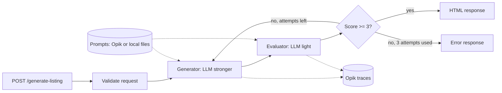

# real-state-web-generator

A small FastAPI service that turns structured property data (JSON) into SEO-optimized HTML listings in English, Portuguese or Spanish. It is an educational example of LLM generation, automatic evaluation with retries, tracing and prompt management.

## Features
- Generates structured HTML: title, meta description, description, key features, neighborhood and call to action
- Multilingual: `en`, `pt`, `es`
- An LLM judge scores each result; the listing is regenerated up to 3 times while the score is below 3/5
- Optional tracing and prompt management with [Comet Opik](https://github.com/comet-ml/opik)
- Evaluation datasets and fact-based metrics (see [docs/EVALUATION.md](docs/EVALUATION.md))

## Architecture

The generator uses the stronger model and the evaluator the light one. The defaults are in `app/chains.py`; override them with `GENERATOR_LLM` and `EVALUATOR_LLM`.

## Quick start
```bash
python3.12 -m venv venv
source venv/bin/activate          # Windows: .\venv\Scripts\Activate.ps1
pip install -r requirements.txt
cp .env.example .env              # then set OPENAI_API_KEY
python -m app.main                # API on http://localhost:8000
```
Optional demo page (in another terminal): `python -m http.server 5500`, then open `http://localhost:5500/public/`.

## Configuration
| Variable | Required | Description |
|---|---|---|
| `OPENAI_API_KEY` | yes | OpenAI API key |
| `GENERATOR_LLM` | no | Model that generates the listing (default `gpt-4-turbo`) |
| `EVALUATOR_LLM` | no | Model that scores it (default `gpt-4o-mini`) |
| `OPIK_URL_OVERRIDE` | no | Opik API URL, e.g. `http://localhost:5173/api`. Turns on tracing and Opik prompts |
| `OPIK_PROJECT_NAME` | no | Opik project for traces |

## API usage
`POST /generate-listing`
```json
{
  "title": "T3 apartment in Lisbon",
  "location": { "city": "Lisbon", "neighborhood": "Campo de Ourique" },
  "features": {
    "bedrooms": 3, "bathrooms": 2, "area_sqm": 120, "balcony": true,
    "parking": false, "elevator": true, "floor": 2, "year_built": 2005
  },
  "price": 650000,
  "listing_type": "sale",
  "language": "en"
}
```
Response:
```json
{
  "html": "<title>...</title>\n<meta ... > ...",
  "evaluation": {
    "structure_compliance": 5,
    "language_fluency_seo": 4,
    "multilingual_adaptability": 4,
    "total_score": 4,
    "missing_or_invalid_tags": []
  },
  "retries": 0,
  "failed_criteria_log": []
}
```
Only `title`, `location.city`, `listing_type` and `language` are required. If something fails, the API returns `{"error": "..."}`.

## Project structure
```
app/
  main.py            FastAPI app and the route
  chains.py          generator, evaluator and retry loop
  prompt_loader.py   prompts from Opik, local files as fallback
  models.py          request models
  prompts/           prompt templates (examples and fallback)
evaluation/          datasets, metrics and the evaluation run
docs/EVALUATION.md   how the evaluation works
public/index.html    demo page
```

## Observability and prompts (optional)
Everything here is off unless `OPIK_URL_OVERRIDE` is set.

1. Start Opik locally (needs Docker and git): `scripts/opik.sh`. It fetches the official compose files into `.opik/` (git-ignored) and starts a lightweight stack (MySQL, Redis, ClickHouse, ZooKeeper, MinIO, backend and UI; no python-backend or guardrails). The first run pulls several images. UI at `http://localhost:5173`. Other commands: `scripts/opik.sh down` (stop, keep data), `status`, `logs`, `reset` (stop and delete data). For educational use only; for anything else follow the [official guide](https://www.comet.com/docs/opik/self-host/local_deployment).
2. Set `OPIK_URL_OVERRIDE` in `.env` and restart the API. Each request shows up at `http://localhost:5173` as one trace; each attempt is tagged `attempt-N`.
3. Prompts: `app/prompts/*.txt` are examples and the fallback. Run `python -m app.prompt_loader` to push them to Opik as `real-estate-generator` and `real-estate-evaluator`. If those exist in Opik, they are used instead (latest version, read at startup; the log says which source was used). Variables use Mustache with triple braces, e.g. `{{{property_json}}}`, so HTML is not escaped.

## Evaluation
Datasets in `evaluation/datasets/` are run through the generator and scored with fact precision and fact recall in an Opik experiment: `python -m evaluation.run` (paid API calls). Details in [docs/EVALUATION.md](docs/EVALUATION.md).

## License
MIT License – free to use and modify.
