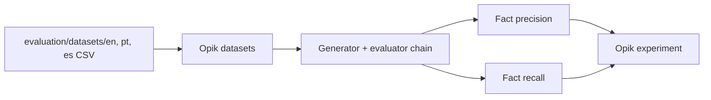

# Evaluation

The evaluation checks one thing the LLM judge in the API cannot: whether the listing states the **facts** it was given, and nothing else.



## Run it
You need Opik running and `OPIK_URL_OVERRIDE` set (see the README). A run calls the OpenAI API for generation and for the judge inside the retry loop, so it costs money.

```bash
python -m evaluation.run                 # all languages
python -m evaluation.run --language pt   # one language
python -m evaluation.test_metrics        # offline checks of the metrics, no API calls
```

## Datasets
`evaluation/datasets/{en,pt,es}.csv`: 50 synthetic rows each (25 sale, 25 rent), including rows with missing optional fields. Columns are described in `evaluation/datasets/README.md`. Each language becomes an Opik dataset named `real-estate-<language>`.

## Metrics
Both metrics are deterministic (no LLM) and live in `evaluation/metrics.py`. They compare the **numbers** in the listing with the input: bedrooms, bathrooms, area, floor, year and price. Numbers can be digits (`€420,000`, `420.000`) or words in en/pt/es (`dois`, `third`).

- **Fact precision**: of the numbers stated in the listing, the share that exists in the input. Low means the model invents details, the worst failure for a real estate listing.
- **Fact recall**: of the numbers in the input (`expected_facts` column), the share found in the listing. Low means the listing omits data it was given.

Plain accuracy was not used: for free-form HTML there is no single correct answer, and structure is already checked by the judge and the retry loop.

## Reading the results
Open Opik (`http://localhost:5173`), go to the experiments of the dataset and compare runs, for example before and after a prompt change. Each row shows both scores and a reason (the unsupported or missing numbers).

## Known limitations
- Only numbers are checked, not yes/no features such as balcony or elevator.
- Incidental numbers in the text ("5 minutes from the metro") count against precision.
- Ambiguous words are ignored (`quarto`/`cuarto` mean "room"), and "one" words are skipped for precision because they are often articles.
- A failed generation scores 0 and is marked as a scoring failure.
- The datasets are synthetic and small.
