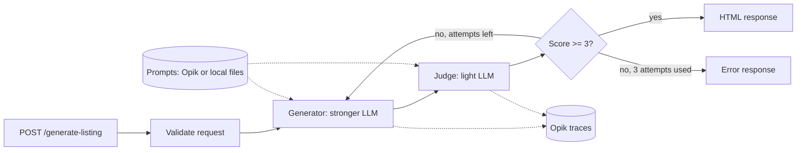

# Architecture

## The big picture



In words:

1. A client sends property data.
2. FastAPI checks it has the right shape.
3. The **generator** LLM writes the HTML.
4. The **judge** LLM reads that HTML and gives scores as JSON.
5. If the total score is **3 or more** (out of 5), we return the HTML.
6. If not, we try again, up to **3 attempts**. After that we return an error that says what failed.

## Two LLM roles

| Role | Job | Model |
|---|---|---|
| Generator | Turns property JSON into HTML | Stronger model |
| Judge ("LLM as judge") | Scores the HTML on 3 criteria and lists missing tags | Light model |

The judge returns JSON like this:

```json
{
  "structure_compliance": 5,
  "language_fluency_seo": 4,
  "multilingual_adaptability": 4,
  "total_score": 4,
  "missing_or_invalid_tags": []
}
```

- `structure_compliance`: are all 7 required tags there, and are the lengths right?
- `language_fluency_seo`: is the writing good and useful for search engines?
- `multilingual_adaptability`: is it in the right language and natural?

## The retry loop

The judge is strict. If the score is under 3, the loop runs again with a fresh generation. Each failed try is saved in `failed_criteria_log` so you can see what went wrong. The limits are `MAX_RETRIES = 3` and `MIN_SCORE = 3` in `app/chains.py`.

## Files

```
app/
  main.py            FastAPI app and the POST /generate-listing route
  chains.py          generator chain, judge chain and the retry loop
  models.py          request models (PropertyData, Location, Features)
  prompt_loader.py   loads prompts from Opik, local files as fallback
  opik_sync.py       on startup, creates missing prompts and datasets in Opik
  prompts/           prompt templates (.txt) used as examples and fallback
evaluation/
  datasets/          50 rows per language (en, pt, es) as CSV
  dataset.py         loads the CSV files
  metrics.py         fact precision and fact recall
  run.py             runs an experiment in Opik
  test_metrics.py    offline checks of the metrics
public/index.html    demo page that calls the API
scripts/opik.sh      starts and stops a local Opik with Docker
docs/                this documentation site
```

## How prompts are loaded

Prompts are plain text files in `app/prompts/`. They use Mustache variables with triple braces, like `{{{property_json}}}`, so HTML is not changed (escaped).

1. When the API starts, `opik_sync.py` pushes the prompts to Opik as `real-estate-generator` and `real-estate-evaluator`, **only if they do not exist yet**. It never overwrites what you edited in Opik.
2. It also creates the datasets `real-estate-en`, `real-estate-pt` and `real-estate-es` the same way.
3. `prompt_loader.py` asks Opik for the **latest version** of each prompt. If Opik is off or the prompt is missing, it uses the local file. The log says which source it used.
4. Prompts are read once, when the API starts. After you edit a prompt in Opik, restart the API.

## Tracing

When Opik is on, every request becomes one **trace** called `generate_listing`. Each LLM call inside it is a **span**, and each attempt is tagged `attempt-1`, `attempt-2`... See [Observability with Opik](observability.md).

## Good to know

- Opik is optional. With no `OPIK_URL_OVERRIDE`, the API works the same, without traces.
- The API allows browser calls only from `http://localhost:5500` (CORS).
- An unknown language falls back to English.
