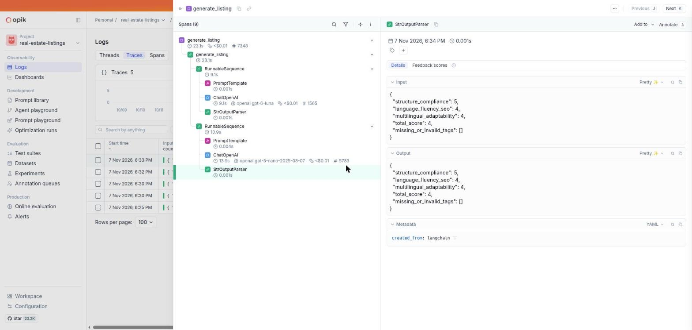
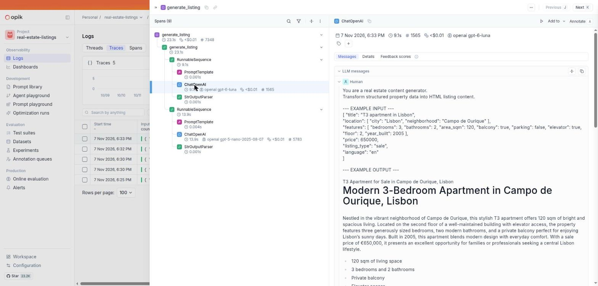
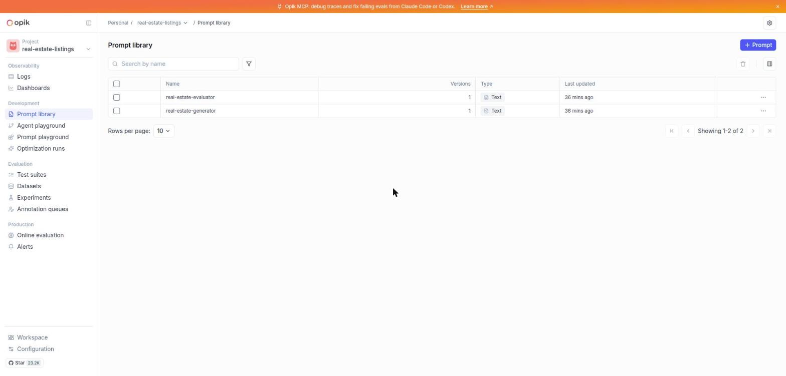
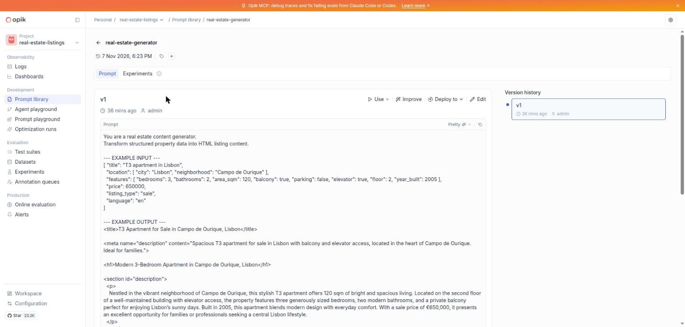
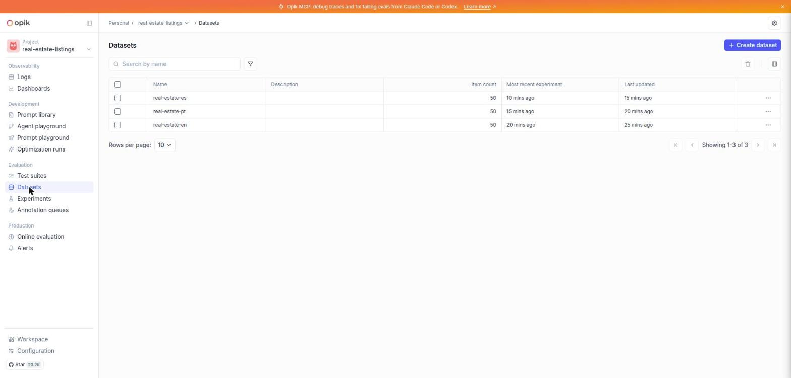
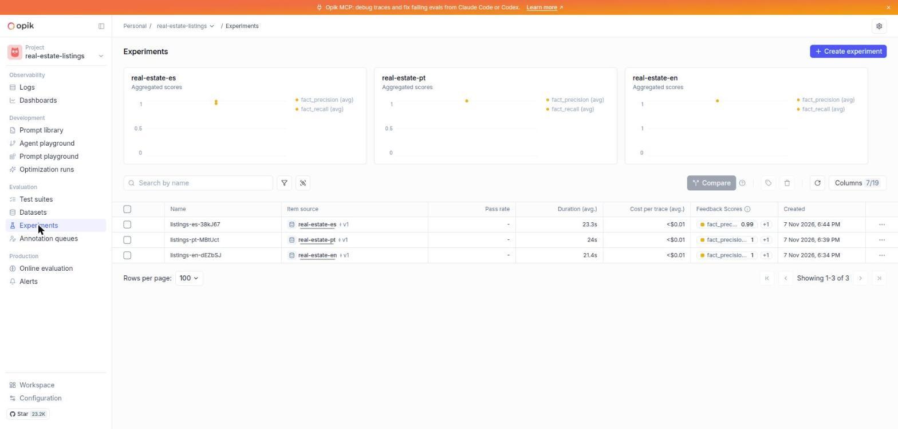
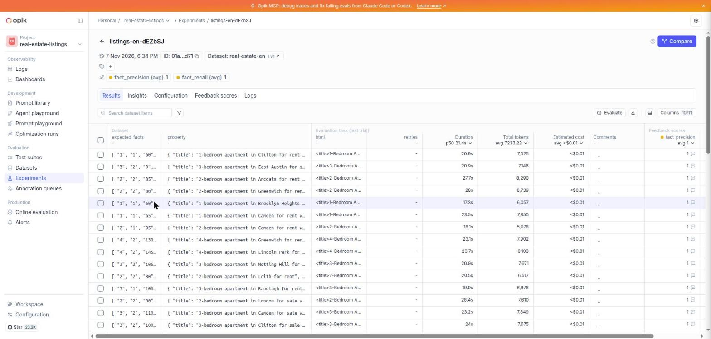

# Observability with Opik

[Opik](https://github.com/comet-ml/opik) lets you look inside the app. Start it with `scripts/opik.sh` and open `http://localhost:5173`. The screenshots below come from a real local run.

## Traces and spans

A **trace** is one full request. A **span** is one step inside it.

Here one request to `generate_listing` took about 23 seconds and has 9 spans. There are two chains, run one after the other:

1. **Generator chain:** `PromptTemplate` (fills the prompt) -> `ChatOpenAI` (the model call) -> `StrOutputParser` (gets the text).
2. **Judge chain:** the same three steps for the evaluator.

For every span you can see the time, the number of tokens and the cost.

## The generator call

This is the exact message sent to the generator model (`gpt-6-luna`): the instructions, the example, and the property data. When a listing looks wrong, start here and check what the model was really asked.

## LLM as judge

In the first screenshot, the second chain uses `gpt-5-nano`. It is the **judge**. Its output is JSON with the scores (`structure_compliance`, `language_fluency_seo`, `multilingual_adaptability`, `total_score` and `missing_or_invalid_tags`). If `total_score` is below 3, the app tries again and you will see more spans, tagged `attempt-2`, `attempt-3`.

## Prompts

Opik keeps a **Prompt library** with versions.

There are two prompts: `real-estate-generator` and `real-estate-evaluator`. They are created for you when the API starts.

Open one to read it, see the version history and edit it. A new version is used the next time the API starts.

## Datasets

A **dataset** is a list of test cases.

There is one per language: `real-estate-en`, `real-estate-pt` and `real-estate-es`, with 50 properties each. They are also created at API startup.

## Experiments

An **experiment** runs every item of a dataset through the app and scores each result.

Each run has two scores, averaged over all items: `fact_precision` and `fact_recall`. A `1` means every number was right. Learn what they mean in [Evaluation](evaluation.md).

Open one run to see every item: the input property, the generated HTML, the tokens, the cost and the scores. Use it to compare runs before and after you change a prompt.
